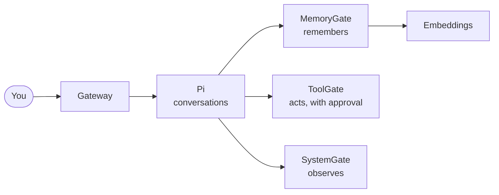

<h1 align="center">Conker</h1>

<b>A personal AI companion you host yourself.</b> 
It remembers you, shows its work, and never acts without your say.

  <a href="https://github.com/Conker-AI/conker">Get started</a> ·
  <a href="https://github.com/Conker-AI/conker/blob/main/docs/2-how-it-works.md">How it works</a> ·
  <a href="https://github.com/Conker-AI/conker/blob/main/docs/status.md">What works today</a>

---

Conker is an everyday AI chat that runs on your own server. It remembers across conversations,
follows up on a schedule, and acts through tools, and every action that touches the outside world
waits for your approval, once, for exactly what you were shown.

It is built as small services with one job each, so every boundary is a process boundary:

| Repository | Job |
|---|---|
| [**conker**](https://github.com/Conker-AI/conker) | The app, deployment and docs. Start here. |
| [**pi**](https://github.com/Conker-AI/pi) | Runtime and gateway: conversations, model routing, an append-only record of every turn |
| [**toolgate**](https://github.com/Conker-AI/toolgate) | The only way to act: typed tools, exact single-use approvals, spending limits |
| [**memorygate**](https://github.com/Conker-AI/memorygate) | Memory with sources: evidence in, bounded context out |
| [**systemgate**](https://github.com/Conker-AI/systemgate) | A read-only view of the machine |
| [**embeddings**](https://github.com/Conker-AI/embeddings) | Text to vectors, and nothing else |

Each service is MIT-licensed and usable on its own. Conker is early: see
[status](https://github.com/Conker-AI/conker/blob/main/docs/status.md) for what is live and what is
still preview.
